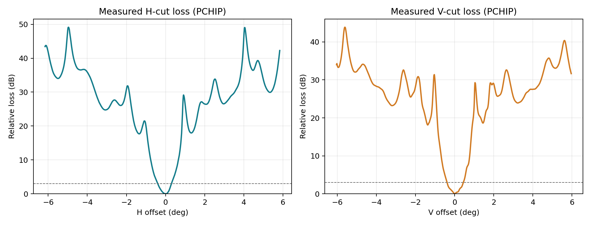
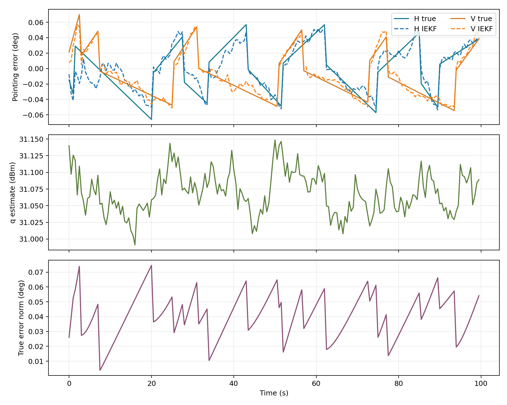
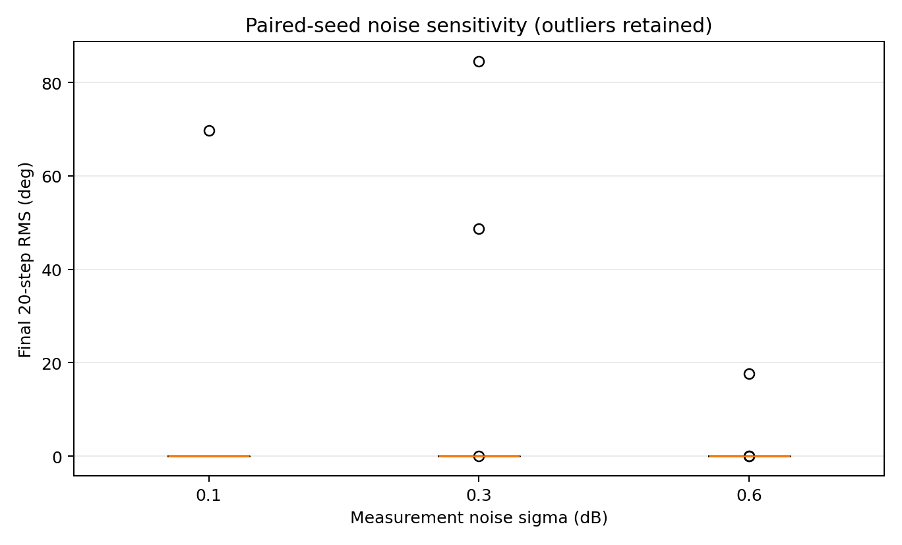
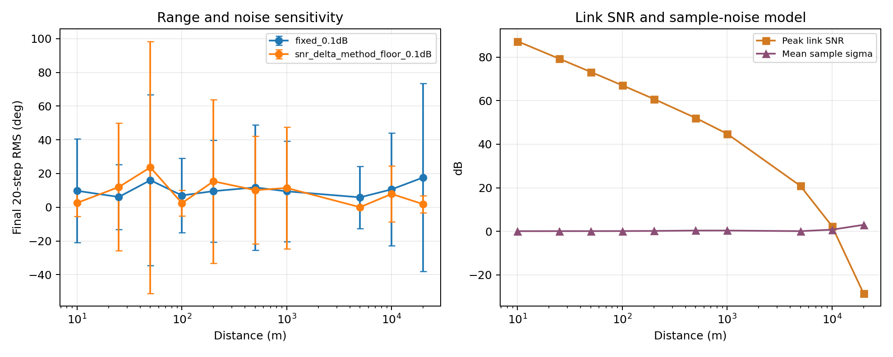
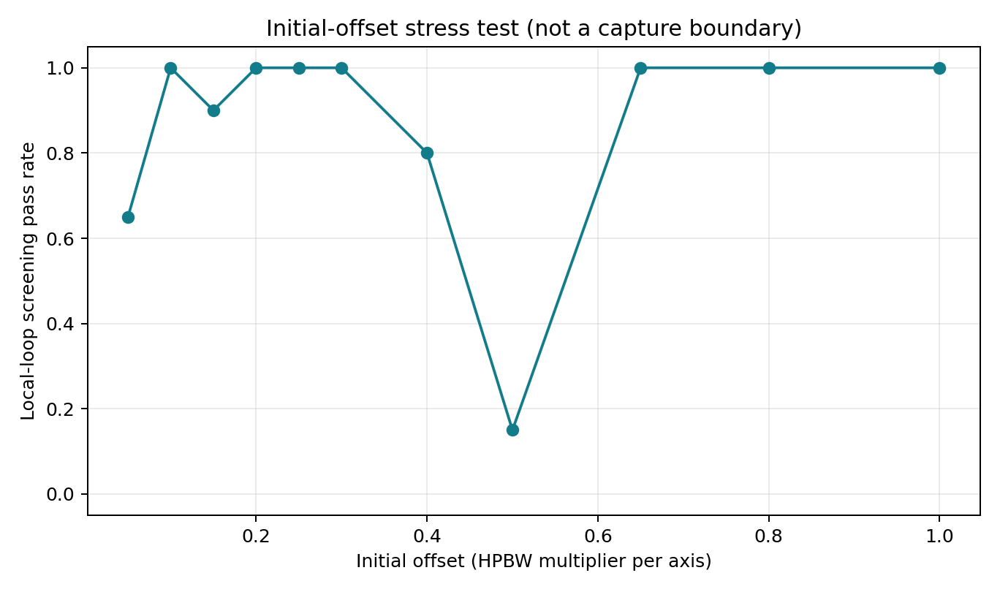
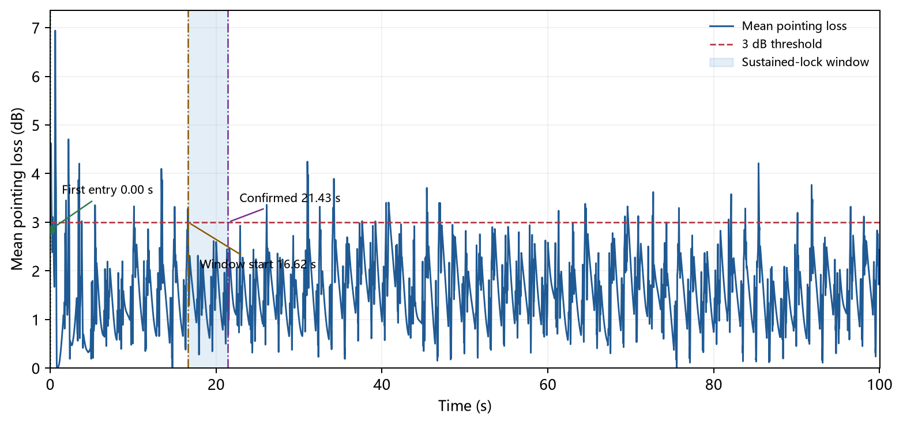

# 220 GHz 太赫兹闭环机械跟瞄（阶段一、二复现）

这个仓库记录 220 GHz 窄波束链路的阶段一、二复现。代码读取实测天线 H/V 切面，在此基础上加入自由空间损耗和 ITU-R P.676-12 大气吸收，并运行单端、静态视距条件下的六状态 IEKF-PI 局部闭环。补充实验也一并保留，用来检查噪声、距离和初始偏差对结果的影响。

目前只覆盖阶段一、二。双向时隙、被动端状态冻结、运动平台和振动工况没有作为已验证结论发布。

## 内容

- `src/`：100 m 基线、补充敏感性实验、连续跟踪代表性算例和捕获窗口测试。
- `data/`：仿真读取的天线实测切面工作簿。
- `results/`：可直接查看的结果图，以及对应的摘要 CSV/JSON。
- `docs/`：技术说明、`agent.md` 和中文 Word 汇报报告。

## 做了什么，结果怎么样

### 实测方向图与 100 m 链路预算

程序从 `data/LWB_CRS-220-100MM-2406-2.xlsx` 读取 601 组 H/V 方向图数据，对每个切面采用 PCHIP 插值，并使用 H/V 可分离的二维工程近似。实测峰值增益为 H/V `44.955/44.691 dBi`，3 dB 波束宽度为 `0.7026°/0.8328°`。这说明波束很窄，零点几度的偏差就会引起明显的接收功率变化。

100 m 时，自由空间损耗为 `119.296 dB`，P.676-12 气体吸收为 `0.249 dB`，在当前接收机参数假设下，预算峰值 SNR 为 `67.05 dB`。这是链路预算，不是实测通信距离或设备认证指标。



### 单端静态局部闭环

滤波状态包含公共功率基线、基线变化率、H/V 两轴误差和两轴角速度。公共功率基线负责解释整体幅值变化，角度主要由不同扫描方向之间的相对功率差识别。它能减轻幅值变化和角误差的耦合，但不能消除方向图误差、扫描异步或离开主瓣后的局部模型失效。

100 m 基线采用固定随机种子，运行 100 s、采样周期 0.5 s。最终误差范数为 `0.054135°`，最后 20 步 RMS 为 `0.043232°`；200 个 IEKF 批次均被接受，最小协方差特征值为 `4.7381e-6`，解析雅可比与中心差分的最大差异为 `2.2918e-9`。这只能说明在当前局部初值和静态假设下，闭环没有数值发散，并把误差压到较小量级；不能直接当作设备稳态指向精度。



### 噪声、距离与局部捕获压力测试

100 m 配对随机种子试验保留离群轨迹。假设测量噪声为 0.1、0.3、0.6 dB 时，本地筛查通过数分别为 `19/20`、`18/20`、`19/20`。量测批次被接受不代表控制误差一定收敛，不能只看更新接受率。



距离扫描对比了固定噪声和 SNR 驱动噪声两种写法。固定 0.1 dB 噪声会让远距离结果显得过于乐观，因为噪声不随接收功率改变。使用 SNR 驱动的 delta-method 假设后，5 km 峰值 SNR 为 `20.88 dB`，10 次本地筛查均通过；10 km 与 20 km 的峰值 SNR 分别为 `2.43 dB` 和 `-28.46 dB`，均为 `0/10`。低 SNR 区间已经超出该近似的可靠范围，所以这是模型压力测试，不能解释成物理最大通信距离。



初始偏差压力测试没有给出单调的“捕获半径”。例如特定偏差方向下，`0.50 HPBW` 仅有 `3/20` 通过，但 `0.65 HPBW` 和 `1.00 HPBW` 又达到 `20/20`。二维初值方向、扫描几何和随机噪声都会影响局部 IEKF-PI 的结果，因此不能从这组数据给出一个通用捕获范围。



代表性连续跟踪算例区分“第一次进入 3 dB 区域”和“持续锁定确认”。首次进入为 `0.00 s`，持续窗口起点为 `16.62 s`，确认时间为 `21.43 s`。确认时间取决于设置的驻留判据，是仿真定义的指标，不是硬件锁定时间。



## 复现方法

建议使用 Python 3.11。在仓库根目录安装依赖：

```bash
python -m pip install -r requirements.txt
```

运行 100 m 阶段一、二基线：

```bash
python src/stage1_2_thz.py --distance-m 100 --output-dir results/stage1_2_100m
```

该命令读取 `data/LWB_CRS-220-100MM-2406-2.xlsx`，生成 JSON 摘要、逐步 CSV 和两张基线图。运行补充实验：

```bash
python src/stage1_2_supplementary_experiments.py
```

补充实验输出到 `results/supplementary/`，运行时间比单次基线长。检查捕获窗口逻辑：

```bash
python -m unittest src/test_capture_window.py
```

运行代表性连续跟踪算例：

```bash
python src/main_THZ_220GHz_deterministic_mechanical_tracking.py --experiment representative --runs 1 --output results/capture_semantics
```

## 当前边界

现有结论严格限定在实测 H/V 切面、单端静态视距、局部初始化和当前接收机噪声假设下。接收机检测噪声、AGC、量化和积分时间尚未由硬件标定，因此距离与噪声结果主要用于看模型敏感性，不能直接外推到真实设备。更合理的下一步是先用实测输入功率标定接收链路，再重新跑距离和捕获实验；然后再做双向时隙和运动场景。

## 未提交的生成物

逐步时序 CSV、Python 缓存、Word 临时锁文件和本地渲染检查文件没有提交。它们是可再生中间文件；复现代码、输入数据、结果图、摘要数据和汇报报告均已提交。
